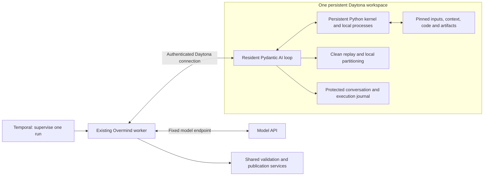

# Native Data Workshop: one agent workspace

Status: resident runner implemented; live qualification and Titanic trials are recorded in `scripts/workshop-resident-trial.md`. This document distinguishes the implemented POC from remaining production recovery work.

## Runtime boundary

The complete Pydantic AI model/tool loop lives in one persistent Daytona workspace with its conversation, Python kernel, data, scripts, experiments, replay outputs and journal. Python, SQL, shell subprocesses and file operations run locally. The agent receives an objective and pinned input/context files. It does not use MCP, a webpage, package downloads or a remote data job for each experiment.

The worker relays model requests, explicit publication requests and retained visual responses. It does not select tools or execute the reasoning loop. The authenticated Daytona control connection carries a durable request/response mailbox, so local development reaches the existing local platform without exposing an HTTP endpoint or opening sandbox egress. Model and platform account credentials remain outside Daytona. Losing the coordinator leaves local computation running; the next model or publication request waits for reattachment.

Temporal uses a whole-run `supervise_run` activity, with an independent heartbeat while bootstrap or external I/O is in progress. It does not create activities for individual model turns or local tool calls. A reconciliation failure fences publication authority and retains the workspace. Modal remains outside this preparation path, serving existing training and inference workloads.

## Task lifecycle

1. Admit a project-scoped, idempotent task and claim the project's single-writer workspace.
1. Pin a landed source cell and fingerprint before network I/O. Verify the locked image, copy and checksum original files and Parquet, then stage the objective, project context, taxonomy and executable contracts.
1. Start or attach the resident runner under an exclusive process lock. The agent explores source meaning and risks, keeps ordinary notes, writes code, tests and repairs it. There are no per-action structured planning gates.
1. Retain a ZIP package and execute its declared steps in fresh child processes in the same workspace. A separate replay UID and Linux Landlock restrict filesystem reads to declared replay files and installed runtime libraries. Exploratory memory and scratch files are unavailable.
1. Reconstruct lineage locally using shared domain logic, then build any declared contamination-aware partition. Keep original labels and duplicates unless the objective and evidence justify changes. A `group_by` list connects rows sharing any listed key; compound tuple groups require a single derived key.
1. Submit one retained publication request. Overmind downloads protected replay receipts and bytes, checks the pinned runtime/source/package/output identities, and passes retained outputs through the existing pipeline publisher. No second transformation execution occurs. The publisher independently checks schemas, consumers, row checks and lineage. Partition verification checks coverage, inherited contamination keys and holdout rules. Versions and partition members commit in one database transaction.
1. Return actual version identities and fingerprints to the resident agent. Completion requires a publication. Retain evidence and close the task kernel while leaving the workspace and kernel supervisor running.

Native publication is recorded as `native_workspace`, never as an external import. Existing external coding-agent and package-runner entry points retain their domain services. The superseded external reasoning/dispatch/planning implementation has been removed.

## Recovery actually implemented

| Event                               | Behavior                                                                                                                            |
| ----------------------------------- | ----------------------------------------------------------------------------------------------------------------------------------- |
| Python exception                    | Local traceback; variables and files remain available for repair.                                                                   |
| Repeated execution submission       | Same execution UUID and content return the saved receipt; changed content conflicts.                                                |
| Resident runner loss                | Reload the conversation checkpoint and reconcile the same local execution or external request ID. The live kernel can continue.     |
| Coordinator loss                    | Resident computation continues. Reattach to the protected mailbox; acknowledged model replies and publications are reused.          |
| Model acknowledgement lost          | Mark uncertainty; do not submit another paid request or execute an unseen tool call.                                                |
| Publication acknowledgement lost    | Reuse the same request key and payload digest; shared services return the same publication.                                         |
| Kernel/supervisor loss              | Existing session machinery fences unknown execution. Python memory is not recoverable. This is distinct from a runner-only restart. |
| Pause/cancel or revoked authority   | Stop admission of new actions and reject publication; retain run records and workspace ownership until settled.                     |
| Runtime source changes during a run | Publication validates against the task's pinned release and workspace generation, not the current checkout's hash.                  |

Conversation checkpoints are mirrored to local platform storage; retained publication packages and dataset outputs use platform storage. Operator workspace checkpoints preserve validated file ownership and modes, reject special files and setuid/setgid entries, and keep the old workspace for rollback.

Automatic recovery from complete workspace loss is **not qualified**: restoring every unpublished working file and resuming under a new fenced generation still needs a tested protocol. Checkpoint files alone do not establish disaster recovery. Cancellation of arbitrary descendant processes also needs broader adversarial qualification beyond the tested kernel/replay paths.

## Scaling tradeoffs

The POC allows one active writer per project workspace, with a private always-running 4 CPU / 8 GiB RAM / 10 GiB disk environment. This pays an idle resource cost in exchange for warm libraries, data and interactive state. Project workspace limits currently determine admission; a pool is not implemented.

Model requests, publication and visual-response retention cross the worker boundary; local computation does not. The mailbox is polled over Daytona's authenticated process API. This adds latency and control-plane traffic, and each active run holds a supervision activity. A later streaming transport can replace polling without moving reasoning back out of Daytona.

Replay and partition preparation currently materialize populations in memory. Streaming scripts do not remove that harness-level ceiling. Larger datasets require bounded Arrow/SQLite processing before this can be called a general large-data runtime. The retained package has existing file/count/size limits. Dependency gaps require a new immutable image.

Usage is measured without a total token budget. Full history is resident; long-running context compaction remains a separate design problem. Tool observations are rendered compactly, with complete receipts available locally. Model quality, semantic correctness and production reliability are not implied by valid schemas or successful execution.

## Verification bar

Qualify the runtime with a deterministic model stub before live inference: local exploration, deliberate error/repair, crash during active execution, exactly-once effect reconciliation, isolated replay that rejects scratch reads, local partitions and terminal cleanup. Publication tests separately verify source lineage, role membership, idempotency and tamper rejection.

Then run fresh data with the minimal user intent, retain all failures and interventions, and audit every published row and split independently. Titanic is one fixture; it does not establish all data modalities, intents, production scale or measured downstream model quality.
