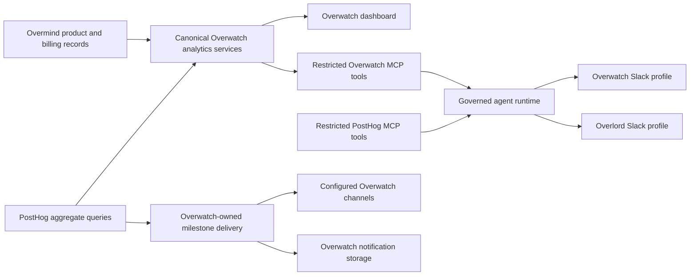

# Overwatch and Overlord MCP architecture

## Proposed design: two agents, shared governance

Overwatch is the product and customer insights specialist. Its dashboard remains
our main analytics interface, and its Slack identity handles analytics questions
and funnel notices. Overlord is the broader company agent.

The two Slack identities should use the same governed agent runtime when the
integration is implemented. Overlord already resolves employees, restricts tools
by capability and conversation, and records metadata audits. Reuse those rules
with an analytics-only Overwatch profile rather than maintaining two different
permission systems. Overwatch must not inherit Overlord's HR or personal tools.

The current branch contains a standalone Overwatch Slack adapter. It is disabled
unless explicitly configured. It is a provisional surface, not evidence that
the shared runtime or either MCP connection has been implemented.

Overwatch's access to the product backend is read-only. Notification state,
deduplication and retries belong to Overwatch's own storage. This PR adds no
product database models, migrations, indexes or periodic writers, and does not
change shared Python dependencies or core product business logic.

## Source and metric definitions

Use Overwatch tools for customer context, billing, payments, credits and recorded
product milestones. PostHog owns behavioral exploration, retention and ordered
conversion funnels. Keep named metric definitions in one place and reuse the
same definitions in the dashboard and agent answers.

Database milestone counts are independent adoption counts for a signup cohort.
They are not an ordered funnel. First activity inferred from retained records
may differ from the original event after retention deletes older rows. Project
activity identifies a project, not which member performed an action. Do not
present membership attribution as individual behavior.

CLI telemetry can begin with an installation identity before authentication
links it to a Clerk identity. A combined PostHog identity count is not necessarily
a count of registered customers. Join customer data only when the recorded
identity mapping is verified; never join on guessed email or display names.

Every answer must state its source, UTC time window and freshness. Missing or
failed sources must be shown as unavailable, not zero. When definitions or
windows differ, show the difference instead of merging incompatible totals.

## Internal MCP boundary

Expose a small read-only contract built on the same domain services as the
dashboard. Suggested tools are `get_customer_insights`, `query_product_usage`,
`get_milestone_adoption` and `get_customer_milestones`. The adapters call services
directly, not the dashboard's internal REST endpoints.

The existing `/api/mcp/` is a customer-facing, project-scoped API. Internal
analytics crosses customer boundaries. It needs an explicit internal permission
and a dedicated service credential before any tool is registered. Reuse the
existing MCP transport and catalog; do not mount another feature server.

Enforce permission at discovery and again at invocation. A normal customer key,
project key or OAuth grant must neither see nor invoke internal analytics tools.
A company email domain, a model instruction or an unverified caller header is
not authorization. Bind service access to the calling deployment, and bind user
requests to the verified employee, analytics capability and conversation mode.
The dashboard bearer token must not become the MCP service credential.

PostHog MCP supports writes as well as reads. Use its supported read-only mode,
a single approved project, minimum credential scopes and an explicit local tool
allowlist. Do not blindly forward its full catalog. Do not allow arbitrary SQL,
raw event properties, person rows, session replays or customer records into an
analytics model prompt. Read-only access still needs a data policy. PostHog
features that invoke another AI service need separate approval of that data path.

## Private data and operational controls

- Keep named customer records and customer billing detail inside the backend and
  approved private replies. The provisional adapter replaces supplied emails
  with request-local references and renders customer reports locally. Only
  aggregate tool results are returned to its model.
- Require explicit model opt-in and approved internal Slack user IDs. Reject
  deleted, guest, restricted, external and bot accounts. The provisional model
  requests deny data collection and require zero retention routing. Free-text
  questions still require care: email redaction is not a general PII classifier.
- Keep secrets in server-side deployment settings. Never put a service key in a
  `VITE_*` variable, URL, prompt, source file, error message or audit payload.
  Logs contain fixed error codes and redacted task argument metadata. Broker
  payloads are private application data and need restricted access and TLS.
- Proposed funnel alerts use a dashboard user reference rather than an email or
  trace contents. PostHog supplies events; Overwatch stores acknowledgement,
  deduplication and retry state outside the product database. Delivery remains
  at least once; a crash after acceptance can duplicate a notice.
- Browser responses are private and not cacheable. The provisional login uses a
  token scoped to a tab for 30 minutes, with legacy persistent tokens cleared.
  This is browser session expiry; the server-side bearer key remains valid until
  rotated. Employee SSO and individual revocation should replace the shared admin token
  before broader access. Do not expose the internal app without an access gate.

## Implementation and review boundaries

This PR implements dashboard insights, the provisional Slack adapter and
read-only PostHog aggregates. It documents MCP and notification delivery. It
does not expose internal MCP tools or change the Overlord runtime. Earlier
backend delivery prototypes are archived as non-executable examples under
`docs/proposals/`; do not apply their migrations to the product database.

Pritam's integration review should settle the internal service identity and
employee capability mapping, choose the shared runtime profile integration,
and confirm the production access gate. Then add negative tests for discovery,
invocation and private versus public conversations before wiring live MCPs.

References: [PostHog capture API](https://posthog.com/docs/api/capture),
[PostHog MCP](https://posthog.com/docs/model-context-protocol),
[PostHog API authentication](https://posthog.com/docs/api), and
[OpenRouter retention routing](https://openrouter.ai/docs/guides/routing/provider-selection).
