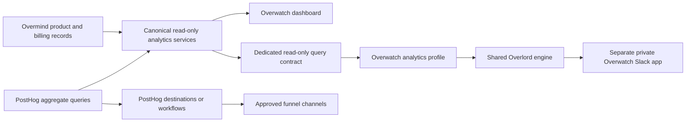

# Overwatch and Overlord MCP architecture

## Two agents, shared governance

Overwatch is the product and customer insights specialist. Its dashboard remains
the analytics interface; its separate Slack identity handles private analytics
questions. Overlord is the broader company agent.

This PR and its companion in `overmind-core/overlord` implement a shared tool
loop with a restricted Overwatch profile. Slack app/workspace verification,
explicit employee authorization and invocation checks run outside the model.
Overwatch cannot inherit Overlord's HR, personal or action tools. The former
standalone backend Slack/model adapter is archived, with no active routes or
Celery tasks. Internal MCP authorization and PostHog funnel-channel activation
remain separate integration steps.

Overwatch's access to the product backend is read-only. Prefer PostHog's native
Slack destinations for events it already collects. Notification state,
deduplication and retries belong in PostHog or, only if needed, a separate
Overwatch service. This PR adds no
product database models, migrations, indexes or periodic writers, and does not
change shared Python dependencies or core product business logic.

## Source and metric definitions

Use Overwatch tools for customer context, billing, payments, credits and recorded
product milestones. PostHog owns behavioral exploration, retention and ordered
conversion funnels. Keep named metric definitions in one place and reuse the
same definitions in the dashboard and agent answers.

Database milestone counts are independent adoption counts for a signup cohort.
They are not an ordered funnel. First activity inferred from retained records
may differ from the original event after retention deletes older rows. Project
activity identifies a project, not which member performed an action. Do not
present membership attribution as individual behavior.

CLI telemetry can begin with an installation identity before authentication
links it to a Clerk identity. A combined PostHog identity count is not necessarily
a count of registered customers. Join customer data only when the recorded
identity mapping is verified; never join on guessed email or display names.

Every answer must state its source, UTC time window and freshness. Missing or
failed sources must be shown as unavailable, not zero. When definitions or
windows differ, show the difference instead of merging incompatible totals.

## Funnel notifications without product changes

Use existing PostHog events or actions with its native Slack destination first.
Route each verified milestone to its configured channel. Add a PostHog workflow
only when the notification needs branching or explicit state. This avoids a new
notification service or product database ledger for simple event alerts.

Source inspection confirms existing producers for `cli.completed`, MCP SDK
analytics, `training_result_available` and `training_check_finished`. It does
not prove those events arrive in the deployed PostHog project, identify a
registered user, or cover every requested funnel step. In particular, a command
completion or tool invocation is not proof that the corresponding business
operation succeeded. Confirm outcome and identity fields before using it.

Before activation, Pritam should confirm the deployed project's event coverage,
define the user or project identity for each milestone, choose first-time versus
repeat alerts, and verify duplicate handling. A saved funnel is an analytics
definition, not evidence that per-person step notifications are configured.
Preview the destination with synthetic data, check channel membership and
privacy, and obtain approval before enabling live messages. Do not replay
historical events into the channels by default.

If a milestone is absent from PostHog, record that gap. An external reader may
use already available read-only backend data, with its own polling cursor and
notification state outside the product database. Any instrumentation change in
core Overmind requires a separate engineering review. The dashboard does not
query the removed prototype's `overwatch_funnel_step` event or present missing
milestone instrumentation as zero conversions.

References: [Slack destination](https://posthog.com/docs/data-pipelines/destinations/slack),
[workflow builder](https://posthog.com/docs/workflows/workflow-builder).

## Internal MCP boundary

Expose a small read-only contract built on the same domain services as the
dashboard. Suggested tools are `get_customer_insights`, `query_product_usage`,
`get_milestone_adoption` and `get_customer_milestones`. A future MCP adapter should call these same domain services directly. The implemented Slack profile uses a separate, dedicated internal query endpoint, never the dashboard bearer.

The existing `/api/mcp/` is a customer-facing, project-scoped API. Internal
analytics crosses customer boundaries. It needs an explicit internal permission
and a dedicated service credential before any tool is registered. Reuse the
existing MCP transport and catalog; do not mount another feature server.

Enforce permission at discovery and again at invocation. A normal customer key,
project key or OAuth grant must neither see nor invoke internal analytics tools.
A company email domain, a model instruction or an unverified caller header is
not authorization. Bind service access to the calling deployment, and bind user
requests to the verified employee, analytics capability and conversation mode.
The dashboard bearer token must not become the MCP service credential.

PostHog MCP supports writes as well as reads. Use its supported read-only mode,
a single approved project, minimum credential scopes and an explicit local tool
allowlist. Do not blindly forward its full catalog. Do not allow arbitrary SQL,
raw event properties, person rows, session replays or customer records into an
analytics model prompt. Read-only access still needs a data policy. PostHog
features that invoke another AI service need separate approval of that data path.

## Implemented shared engine and data boundary

The companion Overlord PR extracts one reusable tool loop. Overwatch supplies a
separate hard allowlist, prompt and untraced client; it never inherits HR tools,
admin lookup tools, stored conversations or training trace observers. Each tool
invocation is checked again before dispatch, regardless of administrator status.
Its separate Slack app handles private DMs and ephemeral slash commands only.

`POST /api/internal/overwatch/agent/query/` is the implemented read contract. It
accepts a dedicated service key, rejects the dashboard key and ordinary product
credentials, validates every argument and wraps product queries in a PostgreSQL
read-only transaction. POST avoids logging customer emails in URL parameters.
There is no new public MCP catalog or internal MCP authorization in this change.

Customer reports are rendered locally in the backend and terminate the loop.
Only aggregates reach the model after supplied emails become local references.
Questions are not stored in Overlord or exported as training traces. Slack thread
follow-ups may include up to two earlier questions from the same caller; bot
reports and other users' messages are excluded. Metadata audit uses the existing
Overlord store. A dedicated Redis admission store keeps hashes/IDs/counters,
never question or report content, and is outside the product database.

The profile uses a dedicated direct Anthropic API key and is disabled by default.
The operator must approve its data policy and retention agreement. There is no
automatic zero-retention routing in this direct adapter. Free-text questions may
contain sensitive prose beyond email/credential filters; approval must account
for that. Secrets remain in server settings, never browser variables, prompts,
URLs, audit values or error responses.

Funnel delivery remains a PostHog configuration task, with verified events,
approved channels and a deliberate activation step. No event emitter, delivery
ledger or writer is added to core Overmind. The dashboard's provisional shared
bearer still needs a production access gate and eventual individual SSO.

## Review and deployment

Both PRs require Pritam's review. Backend read-contract deployment must precede
the Slack profile. Configure separate credentials, Redis admission, approved
employees and the model agreement while the profile remains disabled. Create
the separate Slack app from the companion manifest only when deliberately
activating it. There is no merge, live Slack message, live customer query,
PostHog write or production deployment in this implementation task.

Next's post-response execution matches Overlord's interactive runtime and is not
a durable queue: a process failure after acknowledgement may lose a reply. The
user can submit a new question. Model requests, tool rounds and source queries
are bounded; missing or failed sources remain unavailable rather than zero.

Earlier standalone Slack code and product-write prototypes are retained only
as non-executable examples under `docs/proposals/`. Do not restore them beside
the shared runtime. Public/project MCP permissions are unchanged; future
internal MCP integration requires explicit discovery and invocation security.

Companion Slack runtime PR: [overlord#8](https://github.com/overmind-core/overlord/pull/8).
