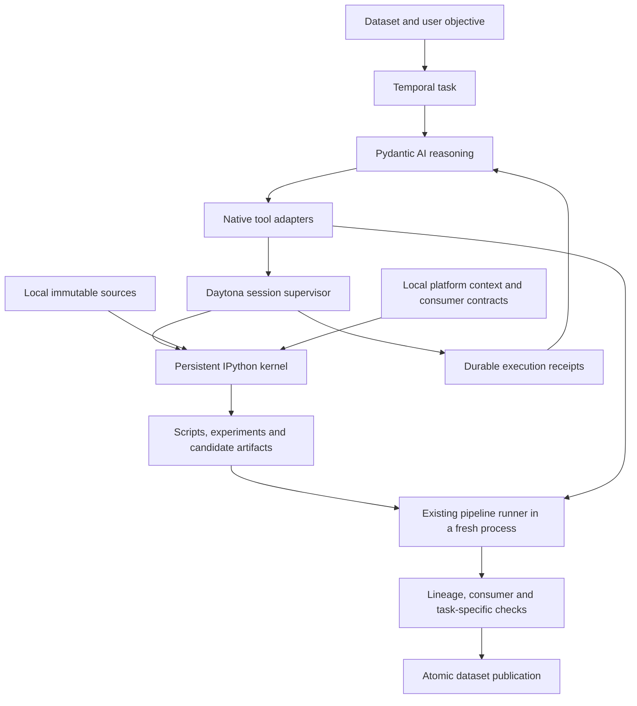

# Data Workshop execution harness: research and recommendation

Research date: 2026-11-06. Status: proposal, not an implemented or qualified runtime.

Architecture update after the persistent-kernel POC: this document retains the
original research and historical recommendation. The current target is
[one resident agent workspace](../NATIVE_AGENT_ARCHITECTURE_PROPOSAL.md), including
the model/tool loop inside Daytona. The split loop shown below is superseded;
kernel qualification alone did not meet the single-environment requirement.

## Recommendation

Build a headless Python notebook runtime inside the persistent Daytona workspace:
`ipykernel` for live execution, `jupyter_client` for kernel control, and a small
Overmind supervisor for execution identity, retained results and recovery. Keep
Temporal for durable orchestration and Pydantic AI for the model loop. Keep the
existing dataset pipeline services for reproducible execution and publication.

The working abstraction is a session containing local data, code, live objects,
results and an evidence record. The model can investigate and repair code in that
session without acquiring a new tool or satisfying a planning ceremony. Publication
remains a separate, validated platform operation.

Jupyter here is a kernel library and protocol. It requires no notebook webpage,
browser, public Jupyter server or second user interface. Native Python adapters
connect the agent to its workspace and Overmind domain services. MCP is not part
of this execution path. Model inference can remain outside Daytona; the code it
generates executes beside the full data. The model sees selected observations,
not every row transported through its context.

## Evidence and limits

I reviewed Hex and Querio's primary documentation, inspected selected source files
in seven public repositories at pinned commits, and compared those patterns with
the current Overmind implementation. This is source analysis, not a performance
benchmark or a claim about undocumented proprietary internals. No third-party
repository was installed or executed during the review.

The current Titanic task was paused for this investigation. Its last observed
state was blocked, with desired state paused, at step 212. It has not produced a
verified training-ready output. A new runtime should be qualified independently
before another autonomous transformation trial.

## What the other systems teach us

| System                                                                                                          | Observed behavior                                                                                                                                                                       | Application to Overmind                                                                                                                                                                                 |
| --------------------------------------------------------------------------------------------------------------- | --------------------------------------------------------------------------------------------------------------------------------------------------------------------------------------- | ------------------------------------------------------------------------------------------------------------------------------------------------------------------------------------------------------- |
| [Hex Notebook agent](https://learn.hex.tech/docs/explore-data/notebook-view/notebook-agent)                     | The agent works with project context, schemas and in-memory project assets, and creates inspectable cells.                                                                              | Supply the working environment and platform context at startup. The agent should work on data immediately. Hex's chat and per-cell confirmation UX are not requirements for our background agent.       |
| [Querio notebooks](https://docs.querio.ai/reference/notebooks)                                                  | Cells have stable identity, source, output and execution state. Saved source/results are distinct from live Python variables. Dependencies determine execution order.                   | Record exactly which code produced an observation. Treat a saved result and a live object as different resources. A successful reactive run does not prove semantic correctness.                        |
| [Jupyter client](https://github.com/jupyter/jupyter_client) and [nbclient](https://github.com/jupyter/nbclient) | Kernel management, correlated execution messages, output/error collection and headless notebook execution are established primitives.                                                   | Reuse the kernel protocol. Build only the platform-specific session and recovery boundary. Use our existing package runner for publication; adding a second notebook publication format is unnecessary. |
| [E2B Code Interpreter](https://github.com/e2b-dev/code-interpreter)                                             | Its inspected server creates Jupyter contexts, serializes execution per context and streams structured outputs.                                                                         | One writer per live namespace. Capture errors and rich results separately from stdout. Its inspected transport interrupts on client disconnection; that is unsuitable as our durable workflow policy.   |
| [marimo](https://docs.marimo.io/guides/reactivity/)                                                             | A variable-reference graph drives reruns and stale state. Its documentation explicitly excludes tracking in-place object mutation.                                                      | Learn from explicit dependency/staleness handling. Do not build a reactive graph as the first prerequisite or treat static dependency analysis as proof of reproducibility.                             |
| [OpenHands SDK](https://github.com/OpenHands/software-agent-sdk)                                                | The inspected implementation retains ordered events and detects repeated action/result, error and context-compaction loops.                                                             | Preserve observations independently of prompt history. Detect repeated unproductive behavior explicitly; do not substitute a token budget or hide execution tools after an error.                       |
| [smolagents](https://huggingface.co/docs/smolagents/reference/python_executors)                                 | Executors maintain execution state. The local executor interprets Python ASTs with restrictions; remote executors include Jupyter-based implementations.                                | Full CPython in an isolated environment fits complex data libraries better than maintaining another Python interpreter. Keep Pydantic AI rather than adding a second agent framework.                   |
| [Microsoft Data Formulator](https://github.com/microsoft/data-formulator)                                       | Its analyst executes exploration code against a workspace and feeds results or failures back into the next iteration. Its research emphasizes branching and revisiting transformations. | Preserve experiments and alternatives, with real execution feedback. Its visualization-oriented output contract is not our model-training contract.                                                     |

Hex's [execution model](https://learn.hex.tech/docs/explore-data/projects/project-execution/execution-model)
and Querio both make dependencies visible. This supports separating exploratory
work from a retained recipe; it does not require us to adopt either product's UI.
Querio's [context model](https://docs.querio.ai/understand/context) also distinguishes
catalog relationships, definitions and reusable procedures. Overmind should supply
its consumer definitions and project facts directly, while keeping agent-inferred
facts provisional until supported by observations.

### Why not simply use Daytona's existing interpreter?

Daytona already documents [persistent Python contexts](https://www.daytona.io/docs/en/python-sdk/sync/code-interpreter/).
I inspected the installed 0.227.0 SDK as well as the published 0.226 reference.
The exposed interface supports context creation and code execution with stdout,
stderr and errors. In that interface I did not find a caller-supplied execution
identity, durable result lookup, rich MIME results or an explicit kernel executable
selection. That is a limitation of the inspected contract, not proof that Daytona
cannot provide those capabilities elsewhere.

Those capabilities matter to our existing runtime image and Temporal recovery.
Use a controlled Jupyter kernel in Daytona as the initial implementation, with
one execution backend. Reconsider the managed interpreter only if its supported
contract and a recovery probe establish equivalent guarantees. Do not maintain
two backends or a silent fallback.

## Problems confirmed in our current harness

1. **Persistent files do not provide a persistent Python session.**
   `workspace.submit_command` creates a Daytona process session per action.
   Separate Python invocations cannot reuse a dataframe or function namespace.
   Scripts can use the local files, but the harness does not offer a shared live
   analysis context.
1. **The ability to investigate can disappear after a failure.**
   `planning.context` accumulates historical investigations, while `require_plan`
   checks only the latest plan for the last failure. A later plan omitting an old
   investigation can block mutation even when its resolution remains in history.
   `reasoning.definitions` then removes workspace execution/write tools. The
   latest trial's unavailable-tool blocker is consistent with this code path.
1. **Documentation became an execution prerequisite.** Earlier consumer guidance
   required external material despite the workspace having no outbound network.
   Recent changes stage our own contracts and installed validators instead. That
   corrects the reference dependency, but does not fix the execution model.
1. **More packages are not the primary missing component.** The image already
   locks pandas, Polars, Arrow, DuckDB, NumPy, SciPy, scikit-learn and text/data
   utilities. The remaining gap is a coherent session, usable observations and
   reliable recovery. The current image does not explicitly include the proposed
   Jupyter kernel stack.

Relevant code: `overbae/services/workshop_agent/{workspace,planning,reasoning}.py`,
`workshop_runtime/{image,environment}.py`, and `docker/workshop/requirements.txt`.
These are findings for the replacement design, not additional patches made by
this research task.

## Proposed architecture

### Workspace and runtime

Keep the Daytona workspace and supervisor running. Retain the task kernel while
the task remains open; maintain a clean warm kernel for the next task without
sharing the previous task's variables. For the POC, admit one active task per
project workspace. Do not run parallel writes against one Python namespace.

The task has these logical areas:

| Area               | Contents and ownership                                                                                                               |
| ------------------ | ------------------------------------------------------------------------------------------------------------------------------------ |
| `inputs/`          | Checksum-verified original files and pinned platform Parquet; read-only to generated code.                                           |
| `context/`         | Source metadata, project/capability context, consumer contracts, validated examples and runtime manifest; platform-owned.            |
| `work/`            | Agent-authored modules, experiments, notes and temporary data.                                                                       |
| `artifacts/`       | Candidate outputs and fitted preprocessing parameters, with checksums and source references. Still untrusted until validation.       |
| Supervisor storage | Execution journal, code snapshots and collected results, outside the kernel user's write authority; mirrored into platform receipts. |

Build one immutable runtime release. Add pinned `ipykernel` and `jupyter_client`
to the existing data environment, including transitive dependencies and required
system libraries. Start the kernel using that exact environment's Python, verify
its executable and imports, and record the image/runtime identity. Package
installation and asset downloads happen during image construction, not during
an agent task. Missing functionality is a runtime capability gap, reported as
such. Future modality profiles can extend the same contract; no single image
should claim to support every possible format or dependency.

The supervisor controls the kernel through local Jupyter messaging. Its narrow
command interface is reachable through authenticated Daytona transport, without
exposing public kernel ports. Provider and platform credentials stay in the
control plane, not in generated Python. Implement and test OS-level separation
between immutable inputs, the supervisor and the kernel; Python restrictions
alone are not an isolation boundary. A kernel context or task directory alone
also does not provide tenant isolation.

### What the model receives

The first turn gets the objective, pinned input handles and paths, a compact source
manifest, runtime readiness, applicable consumer definitions and the native tool
contract. Full reference material remains local and directly readable. Bootstrap
stages the data; the model does not export it or configure a client connection.

Project context identifies applicable capabilities, upstream source provenance,
existing supervision, downstream consumers and known constraints. It is a
versioned snapshot with explicit freshness. Native read operations can refresh
relevant platform facts; publication rechecks current authority and source identity.
Do not stuff the whole platform catalogue into every model request.

The user can still say only “I want to train a decision model on this data”. The
platform supplies what a valid decision example looks like. The agent must infer
the example unit, candidate target, useful inputs, availability at prediction
time and transformation strategy from the data and context. A probability
distribution, hard class label, preference and scalar score must not become
interchangeable merely because they can all be serialized.

### Stable execution tools

Keep a small native surface:

| Capability                    | Contract                                                                                                          |
| ----------------------------- | ----------------------------------------------------------------------------------------------------------------- |
| Execute Python                | Run code in the task's live kernel; return an execution handle and structured results.                            |
| Inspect execution / interrupt | Read retained output and current state; request interruption independently of the model's code.                   |
| Read / write workspace files  | Confined file operations for modules and artifacts. No broad platform credentials.                                |
| Read platform context         | Project-scoped native service calls for information not in the startup snapshot.                                  |
| Validate / publish recipe     | Existing deterministic pipeline services, with pinned source, retained package, consumer checks and request keys. |

Pandas/Polars/DuckDB work directly on local data. SQL is available through the
installed DuckDB library; a separate remote query tool is unnecessary for staged
files. Ordinary code can inspect objects and produce summaries. Add specialized
helpers only when repeated evidence shows a real need.

Execution results separate stdout, stderr, exception details, returned/displayed
values and artifact references. Record kernel generation, code checksum, input
identity and observed timing. Paginate or summarize large observations explicitly;
retain complete results for retrieval. A table preview is labelled as a sample,
not presented as a full-data check. Rich output is an artifact, not trusted HTML
to execute in the Console.

Jupyter supplies request correlation, output channels and kernel control;
it does **not** supply durable job execution or exactly-once arbitrary Python.
The supervisor must own those platform semantics. See the
[Jupyter messaging specification](https://jupyter-client.readthedocs.io/en/stable/messaging.html).

### Exploration and intent reasoning

Use an evidence-driven loop:

1. Inspect actual data: shape, examples, types, missingness, relationships and
   domain meaning. Record uncertainty and identify the intended use.
1. State a working hypothesis and the next discriminating experiment. Maintain
   a short evolving plan, rather than requiring a complete recipe before learning.
1. Execute code, inspect real outputs and revise. Exceptions are normal feedback;
   file editing and execution remain available after them.
1. Build candidate transformations and compare them against the original source
   with checks appropriate to the intended consumer.
1. Retain a standalone recipe and its parameters. Run it afresh, inspect the
   output, then publish through existing services.

Orientation remains first, but an arbitrary script cannot be reliably classified
as “exploration” versus “transformation”. Gates belong at authority boundaries:
source mutation, publication, credentials and downstream launches. Plan text
does not grant or remove the ability to experiment in private scratch space.

Keep an append-only observation history and a compact current assessment linking
claims to execution receipts. Distinguish hypotheses, measured facts and unknowns.
Detect repeated unchanged reads, repeated code/errors and missing capabilities
using execution history. Give specific recovery feedback, then surface a measured
stall if it persists. Context compaction and output-size limits are necessary;
they are not a total-token budget. No arbitrary task token cap is proposed.

### Reproducibility and publication

Live state accelerates investigation. The final product is a source-bound recipe,
not an opaque kernel snapshot. Preserve code, parameters, seeds, source hashes,
runtime identity, lineage and checks. Do not pickle a whole Python namespace as
the recovery or publication format.

Run the retained recipe in the existing clean pipeline environment against the
pinned source. Verify the data-library runtime matches. Its output must not
depend on a forgotten exploratory cell, mutable global or unstaged file. Use
the same executable consumer validators as training. Keep source-row accounting,
joins/fan-out lineage and consumer checks in the deterministic services.

Task-specific semantic checks still require judgment. For training preparation,
this can include target aliases, outcome-time features, duplicate/entity/time
overlap, preservation of distributions and fitting preprocessing on training
only. Checks must examine actual values and relevant relationships. Source-code
keyword searches cannot establish preservation or absence of leakage.

Report technical compatibility, semantic evidence and measured model performance
separately. A valid training file does not establish generalization. Modal remains
the downstream training/inference execution layer; preparing a dataset launches
neither training nor serving.

## Recovery contract

Before dispatch, the platform saves a stable execution ID and code hash. The
supervisor records acceptance durably and serializes commands for the kernel.
An identical request returns the existing execution; a changed payload conflicts.
Journal dispatch intent before sending the Jupyter message. Persist results
independently of the requesting connection, then mirror them to platform storage.

| Failure                           | Required behavior                                                                                                                                                                                                       |
| --------------------------------- | ----------------------------------------------------------------------------------------------------------------------------------------------------------------------------------------------------------------------- |
| Python exception                  | Retain code, error and partial-output status. Keep the kernel available for investigation; an exception may have partially mutated variables/files.                                                                     |
| Connection lost, supervisor alive | Reattach by execution ID and collect the retained result. Losing a client must not automatically stop or repeat the calculation.                                                                                        |
| Temporal worker restarts          | Reconcile saved executions and model responses before asking the model or submitting work again.                                                                                                                        |
| Supervisor fails around dispatch  | If acceptance/execution cannot be proven, mark the outcome unknown and fence further use of that kernel. A Jupyter message ID alone is not deduplication.                                                               |
| Kernel crashes or is restarted    | Advance kernel generation; invalidate live object handles. Keep files and receipts. Restore from explicit verified artifacts or rerun a retained recipe in fresh scratch space, never blindly replay arbitrary history. |
| Long or runaway code              | Interrupt via the supervisor. Confirm idle/termination; if necessary restart the kernel and report lost live state. Execution time/resource limits protect availability without a task token budget.                    |
| Publication response lost         | Reconcile the existing project-scoped request key and run receipt. Never publish another version merely because the reply was lost.                                                                                     |
| Workspace lost                    | Restore verified sources, code and durable artifacts into the same qualified runtime release. RAM is lost; persistent work must not depend solely on Daytona disk.                                                      |

This deliberately does not promise exactly-once execution through every crash.
Unknown outcomes remain unknown. The durable journal and isolated scratch area
make recovery explicit; existing transactional publication protects platform state.

## Scaling tradeoffs

| Choice                                              | Benefit                                                                       | Cost / limit                                                                                                                                            |
| --------------------------------------------------- | ----------------------------------------------------------------------------- | ------------------------------------------------------------------------------------------------------------------------------------------------------- |
| Always-running project workspace                    | Immediate access to loaded tools and local files; preserves ongoing analysis. | Idle CPU/RAM/storage reservation continues. Measure it; do not silently introduce scale-to-zero.                                                        |
| One active task/kernel writer per project initially | Predictable memory use and unambiguous state.                                 | Other tasks queue. Add task-isolated compute only after measured demand.                                                                                |
| Live dataframes                                     | Fast repeated exploration.                                                    | RAM can grow through copies and retained variables. Track process memory and handle kernel loss explicitly.                                             |
| DuckDB / lazy Polars / Arrow batches                | Work on larger staged files without eagerly loading everything.               | Disk and query plans still matter; global joins/sorts/splits cannot be treated as independent row batches.                                              |
| Separate platform workers and workspace compute     | Model requests and orchestration scale independently of data execution.       | Network calls still exist between control plane and compute, with explicit acknowledgement/recovery. They do not move whole datasets through the model. |
| Fresh execution before publication                  | Detects hidden-state dependencies and preserves existing lineage guarantees.  | Additional compute is required once the exploratory recipe is ready.                                                                                    |

No latency, concurrency or cost result has been measured for this proposed kernel
setup. The existing 4 CPU / 8 GiB workspace is a starting test environment, not a
capacity claim.

## First build and qualification

### 1. Prove the environment without an LLM

Build the pinned image and supervisor. Demonstrate direct local source access,
shared variables across executions, structured errors/results, reusable module
editing, interruption and a fresh-process recipe run. Break the client connection,
restart the worker and kill the kernel deliberately. Verify request deduplication,
unknown-outcome handling and intact platform source data. Confirm the kernel
cannot write supervisor state or access provider credentials. Record memory and
execution timings as observations.

This is the first implementation milestone. It isolates environment correctness
from model reasoning quality.

### 2. Attach the native agent

Replace the per-action Python-command path with the stable session contract.
Remove plan-dependent hiding of scratch execution/editing tools. Keep native
domain services, source pinning and publication guards. Supply the compact local
context and meaningful execution feedback. Regression coverage must include an
error followed by a successful repair, and a later plan update that does not
redeclare a previously resolved failure.

### 3. Qualify actual preparation

Start a fresh Titanic task with the same minimal objective and original source,
without a target mapping or transformation recipe in its prompt. Inspect the
result independently: target meaning, exclusion of `alive` from survival inputs,
all row transformations, missingness, duplicate/conflicting-label treatment,
partition overlap and the exact decision consumer contract. Duplicates and
conflicts need a justified policy, not automatic deletion. Fresh replay must
reproduce the retained output under declared determinism rules.

Also use fixtures for nested conversational data, soft/probabilistic decisions,
entity/time splits, joins with fan-out and intent/source mismatch. Titanic alone
cannot qualify a general harness. Distinguish successful transformation from a
correctly reported insufficiency of supervision. Measure completion, correctness,
recovery, wall time, usage and observed cost; no invented readiness percentage.

Delete the replaced command/planning mechanism when the new path is qualified.
Do not add another flag-controlled agent stack. Update the Data Workshop skill,
native architecture/runtime docs and task inspection surfaces with the final
contract. External MCP remains an adapter for external users, not a native-agent
dependency.

## Pinned source review

These commits identify the code read during this review, not dependency versions
selected for the production image.

| Repository / commit                                                         | Files inspected                                                                                                                                                                                                                                                                                                                                  |
| --------------------------------------------------------------------------- | ------------------------------------------------------------------------------------------------------------------------------------------------------------------------------------------------------------------------------------------------------------------------------------------------------------------------------------------------ |
| `jupyter/jupyter_client` · `e8043c08887a26ae1186b7547512e9c8ad8706e2`       | [Kernel manager](https://github.com/jupyter/jupyter_client/blob/e8043c08887a26ae1186b7547512e9c8ad8706e2/jupyter_client/manager.py), client                                                                                                                                                                                                      |
| `jupyter/nbclient` · `0811ff44c63c9853c4d6ba7265d7042ca7f8742a`             | [Execution and output polling](https://github.com/jupyter/nbclient/blob/0811ff44c63c9853c4d6ba7265d7042ca7f8742a/nbclient/client.py)                                                                                                                                                                                                             |
| `e2b-dev/code-interpreter` · `c49b78602c29e44d07e196604de515dfa6b12744`     | [Message handling](https://github.com/e2b-dev/code-interpreter/blob/c49b78602c29e44d07e196604de515dfa6b12744/template/server/messaging.py), contexts, server routes                                                                                                                                                                              |
| `marimo-team/marimo` · `a9dbd8ec05a9ac729cc0d44cc6f6611ed6ae0a77`           | [Cell executor](https://github.com/marimo-team/marimo/blob/a9dbd8ec05a9ac729cc0d44cc6f6611ed6ae0a77/marimo/_runtime/executor/executor.py), dependency graph, reactivity guide                                                                                                                                                                    |
| `OpenHands/software-agent-sdk` · `62d945b630a13e85a8f2efc25ef08e9730c01a1b` | [Event store](https://github.com/OpenHands/software-agent-sdk/blob/62d945b630a13e85a8f2efc25ef08e9730c01a1b/openhands-sdk/openhands/sdk/conversation/event_store.py), [stuck detector](https://github.com/OpenHands/software-agent-sdk/blob/62d945b630a13e85a8f2efc25ef08e9730c01a1b/openhands-sdk/openhands/sdk/conversation/stuck_detector.py) |
| `huggingface/smolagents` · `96f33faaf028479119ec8d34507b47694cf14e34`       | [Remote executors](https://github.com/huggingface/smolagents/blob/96f33faaf028479119ec8d34507b47694cf14e34/src/smolagents/remote_executors.py), local Python executor                                                                                                                                                                            |
| `microsoft/data-formulator` · `5477f0e236426dc8f74a498ec400414fba7fbc0f`    | [Analyst](https://github.com/microsoft/data-formulator/blob/5477f0e236426dc8f74a498ec400414fba7fbc0f/py-src/data_formulator/analyst/agent.py), sandbox contracts/Docker runner, connector-operation executor                                                                                                                                     |

Microsoft's [Data Formulator 2 research](https://www.microsoft.com/en-us/research/publication/data-formulator-2-iteratively-creating-rich-visualizations-with-ai/)
provides additional evidence for preserving alternative exploration paths. Its
visualization study does not establish model-training preparation quality, which
must be measured in Overmind's own qualification suite.
